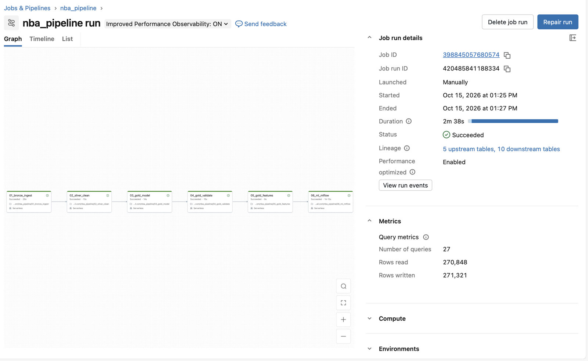

# Empirical Bayes Shrinkage for Small-Sample Shooting Rates

A player who goes 34-for-76 from three "shoots 44.7%," but 76 attempts say very
little about his true ability. This project fits a league-wide Beta prior to NBA
3-point data by maximum likelihood, shrinks each player's percentage toward it in
proportion to how little data he has, and tests whether the shrunk estimates
predict the next season better than raw percentages do. It then benchmarks two
scikit-learn models against the Bayesian estimates. The pipeline runs locally
or as a six-task Databricks Job (see [Running on Databricks](#running-on-databricks)).

## Method

Each player-season *i* has makes $x_i$ out of attempts $n_i$:

$$x_i \mid p_i \sim \text{Binomial}(n_i, p_i), \qquad p_i \sim \text{Beta}(\alpha, \beta)$$

$\alpha$ and $\beta$ are estimated separately for each season by maximizing the
Beta-Binomial marginal log-likelihood:

$$\ell(\alpha, \beta) = \sum_i \Big[\ln B(x_i + \alpha,\ n_i - x_i + \beta) - \ln B(\alpha, \beta)\Big]$$

The optimizer (Nelder-Mead) works on $\log\alpha, \log\beta$ so both stay positive,
starting from method-of-moments estimates. Each player's shrunk estimate is the
posterior mean:

$$\hat p_i = \frac{x_i + \alpha}{n_i + \alpha + \beta} = w_i \frac{x_i}{n_i} + (1 - w_i)\frac{\alpha}{\alpha + \beta}, \qquad w_i = \frac{n_i}{n_i + \alpha + \beta}$$

$\alpha + \beta$ works like a number of league-average "phantom attempts" added
to every player's record.

## Data

- Regular-season player game logs (254,512 game rows) from stats.nba.com via
  [`nba_api`](https://github.com/swar/nba_api), 2015-16 through 2024-25, plus each
  player's age for every season.
- Collapsed to one row per player-season. Kept players with at least 1.5 3PA per
  game and 20 games, which leaves 2,958 player-seasons and 93.6% of all attempts.
  The smallest remaining sample is 32 attempts.

## Results

Fitted priors:

| Season  | Players | α      | β      | Prior mean | α + β |
|---------|--------:|-------:|-------:|-----------:|------:|
| 2015-16 | 226     | 115.09 | 207.61 | 0.3566     | 322.7 |
| 2016-17 | 253     | 130.79 | 233.71 | 0.3588     | 364.5 |
| 2017-18 | 264     | 150.64 | 263.07 | 0.3641     | 413.7 |
| 2018-19 | 302     | 153.49 | 277.69 | 0.3560     | 431.2 |
| 2019-20 | 302     | 137.21 | 244.92 | 0.3591     | 382.1 |
| 2020-21 | 321     | 98.54  | 170.23 | 0.3666     | 268.8 |
| 2021-22 | 331     | 113.27 | 207.90 | 0.3527     | 321.2 |
| 2022-23 | 312     | 138.63 | 245.00 | 0.3614     | 383.6 |
| 2023-24 | 314     | 168.86 | 290.09 | 0.3679     | 458.9 |
| 2024-25 | 333     | 125.85 | 222.16 | 0.3616     | 348.0 |

On average $\alpha + \beta \approx 370$. The model gives a player's own percentage
half the weight only once he has taken about 370 threes in a season. Few players
ever get there: even Anthony Edwards (811 attempts in 2024-25) is pulled about 30%
of the way toward the league average.

**Validation (season *t* predicting season *t*+1, nine consecutive pairs, 2,076 player pairs).**

| Prediction             | RMSE   | Weighted RMSE | MAE    | Calibration slope |
|------------------------|-------:|--------------:|-------:|------------------:|
| Raw 3P%                | 0.0507 | 0.0441        | 0.0393 | 0.308             |
| Shrunk 3P%             | 0.0414 | 0.0356        | 0.0321 | 0.833             |
| League average for all | 0.0438 | 0.0389        | 0.0343 | —                 |

Shrinkage cuts next-season RMSE by 18.5% overall, and it beats raw percentages in
all nine season pairs (by 15% to 25%). The league-average row predicts season *t*'s
prior mean for everyone, which is known at prediction time; shrinkage beats it in
every season pair and every volume bucket. Calibration slope is the slope of
next-season 3P% on the prediction; 1.0 means perfectly calibrated. With raw
percentages it is 0.31: a player predicted 10 points better than another ends up
only about 3 points better, because extreme raw percentages mostly don't repeat.

Shrinkage should matter least for high-volume shooters. Even among players with
400+ attempts, shrunk estimates cut next-season RMSE by 10.9% (0.0329 → 0.0293)
and raise the calibration slope from 0.52 to 0.85.

## Empirical Bayes vs. machine learning

`06_ml.py` trains a Ridge regression and a gradient-boosting model on features EB
never sees: the previous season's 3P% and attempts, a two-season pooled 3P%, FT%,
free-throw attempts, 3PA rate, minutes, games, and age. Evaluation is walk-forward:
each test season is predicted by models trained only on earlier seasons, so no
future information leaks into training.

Pooled over five test seasons (2020-21 through 2024-25, 1,243 player pairs):

| Prediction        | RMSE   | vs. EB | Correlation *r* | Calibration slope |
|-------------------|-------:|-------:|----------------:|------------------:|
| Raw 3P%           | 0.0512 | −22.8% | 0.305           | 0.308             |
| EB shrunk         | 0.0417 | —      | 0.303           | 0.785             |
| League average    | 0.0440 | −5.5%  | —               | —                 |
| Ridge             | 0.0409 | +1.9%  | 0.361           | 0.870             |
| Gradient boosting | 0.0409 | +1.9%  | 0.363           | 0.805             |

- **ML wins 4 of 5 test seasons** (by 3–6%); EB wins 2022-23 → 2023-24 narrowly.
- **EB improves calibration; ML improves ranking.** Shrinking every player toward
  the same mean barely reorders them, so EB's correlation equals raw 3P%'s. Extra
  history and FT% let the models reorder players, raising correlation from 0.30 to 0.36.
- **The gains are largest where one season says the least:** 4.7% under 100
  attempts and 3.1% at 100–199, falling to zero at 400+, where EB is already the best.
- **Ridge and gradient boosting tie.** With about 2,000 noisy rows, the signal is
  close to linear, so the trees' extra flexibility doesn't pay.

## Forecast monitoring: anomaly detection and reporting

A forecast is only useful if its users can tell real surprises from noise. Each
player's season-*t* posterior gives a full predictive distribution for next season's
makes, not just a point estimate:

$$x_{t+1} \sim \text{BetaBinomial}\big(n_{t+1},\ \alpha + x_t,\ \beta + n_t - x_t\big)$$

A season is flagged as an anomaly when its makes fall outside the central 95%
interval. Makes are whole numbers, so the interval covers slightly more than 95%:
on data simulated from the model itself, 4.2% of players are flagged by chance.

| Check (2,076 player pairs)   | Result                  | If the model were exactly right |
|------------------------------|------------------------:|--------------------------------:|
| Flagged as anomalies         | 95 (4.6%): 45 hot, 50 cold | ~4.2%                        |
| Flag rate by season pair     | 2.0% – 6.6%             | ~4.2% ± noise                   |
| Flag rate, under 200 attempts | 5.6% – 5.8%            | ~4.2%                           |
| Flag rate, 200+ attempts     | 3.8% – 4.0%             | ~4.2%                           |
| Predictive percentile (PIT) deciles | 8.8% – 10.9% each | 10% each                       |

The intervals are close to calibrated: the model's uncertainty can be trusted.
Low-volume shooters are flagged slightly more often, the same weakness described
under Limitations. The largest surprise: Danny Green made 198 of 435 threes in
2018-19 when the interval said 134–183.

**Reporting layer.**

- `07_export_powerbi.py` reshapes the results into a star schema for Power BI: two
  fact tables (one row per player pair with anomaly flags; one row per pair × method
  with forecast errors) sharing player, season, volume, and method dimensions. It
  re-computes the RMSE figures above from the new tables as a check.
- `08_build_excel.py` writes [`reports/shrinkage-calculator.xlsx`](reports/shrinkage-calculator.xlsx),
  built entirely from live formulas:
  - **Calculator**: pick a season, enter makes and attempts, and get the shrunk 3P%,
    the weight on the player's own data, and a credible interval (`INDEX/MATCH`,
    `BETA.INV`, input validation).
  - **Accuracy**: RMSE for every method by test season and by volume (`AVERAGEIFS`).
  - **Anomalies**: the 95 flagged pairs, most surprising first.

  The workbook was recalculated in Excel and checked against scipy and the tables
  above.
- A Power BI report on the star schema (forecast accuracy, anomaly monitor, player
  drill-through) is in progress.

## Limitations

- A single prior per season treats every player as coming from the same pool.
  Poor-shooting players with small samples get pulled up toward league average;
  for example, a 14-for-72 season (.194) is shrunk to .333. EB still trusts
  low-volume shooters too much (calibration slope 0.53 at 100–199 attempts vs.
  0.85 at 400+), and beats the league-average baseline there by only 1.7%. A prior
  whose mean depends on volume and FT% (beta-binomial regression) is the natural
  next step; the ML results suggest it is worth 3–6% for these players.
- The season-to-season movement in $\alpha + \beta$ (269 to 459) is probably
  estimation noise. Bootstrap confidence intervals would settle it.
- Survivorship: a pair exists only if the player qualifies in both seasons. Players
  who lose their shooting role, often after a poor season, drop out, so results
  describe players who kept shooting.
- The features overlap heavily (raw, shrunk, two-season, and previous 3P%), so
  individual Ridge coefficients and single-season permutation importances are not
  reliable measures of any one feature's effect.

## Run it

```bash
pip install -r requirements.txt
python 01_pull.py
python 02_clean.py
python 03_model.py
python 04_validate.py
python 05_features.py
python 06_ml.py
python 07_export_powerbi.py
python 08_build_excel.py
python -m pytest
```

Run from the project root. `01_pull.py` caches each season in `data/raw_v2/`, so
reruns skip the API. Data is not committed; `01_pull.py` rebuilds it in about
15–20 minutes. stats.nba.com often blocks requests from cloud servers, so run the
pull on a personal machine.

| Script           | Does                                                              |
|------------------|-------------------------------------------------------------------|
| `01_pull.py`     | stats.nba.com → one CSV of game logs and one of ages per season   |
| `02_clean.py`    | game logs → filtered player-season totals with FT% and 3PA rate   |
| `03_model.py`    | fits each season's Beta prior, writes shrunk estimates            |
| `04_validate.py` | scores raw vs. shrunk against the next season                     |
| `05_features.py` | builds the season *t* → *t*+1 feature table for the ML models        |
| `06_ml.py`       | walk-forward Ridge and gradient boosting vs. EB and baselines    |
| `07_export_powerbi.py` | pipeline outputs → star-schema CSVs with anomaly flags in `data/powerbi/` |
| `08_build_excel.py` | star-schema tables → `reports/shrinkage-calculator.xlsx`      |

`forecast_intervals.py` holds the predictive-interval math used by 07 and 08;
`tests/` checks it, including that about 95% of players simulated from the model
fall inside their interval.

If `import pandas` fails with a NumPy 1.x/2.x error, another Python install (for
example Anaconda's `base` environment) is leaking old packages into the run. A
clean environment avoids it:

```bash
uv run --isolated --python 3.12 --with-requirements requirements.txt python 01_pull.py
```

## Running on Databricks

Steps 02–06 also run as a six-task Databricks Job on serverless compute (Free
Edition). Each notebook in [`databricks/`](databricks/) contains the matching
script's model code unchanged. What changes is where data lives: CSV files become
Delta tables in Unity Catalog, organized as bronze (raw), silver (cleaned), and
gold (analysis-ready) layers, and the ML step logs to MLflow.



| Notebook             | Replaces         | Writes (Delta tables)                                        |
|----------------------|------------------|--------------------------------------------------------------|
| `01_bronze_ingest`   | *(new)*          | `nba_bronze_gamelogs`, `nba_bronze_ages`                     |
| `02_silver_clean`    | `02_clean.py`    | `nba_silver_player_seasons`                                  |
| `03_gold_model`      | `03_model.py`    | `nba_gold_shrunk`, `nba_gold_priors`                         |
| `04_gold_validate`   | `04_validate.py` | `nba_gold_validation_pairs`, `nba_gold_validation_metrics`   |
| `05_gold_features`   | `05_features.py` | `nba_gold_ml_pairs`                                          |
| `06_ml_mlflow`       | `06_ml.py`       | `nba_gold_ml_predictions`, `nba_gold_ml_metrics`, MLflow run |

What the Databricks version adds:

- **Data-quality gate.** `01_bronze_ingest` stops the Job before anything
  downstream runs if a season file is missing, a key is null, a shot count is
  negative, or makes exceed attempts.
- **Lineage.** Every bronze row records its source file and ingestion time, and
  Unity Catalog tracks which tables each task read and wrote.
- **Experiment tracking.** `06_ml_mlflow` logs one MLflow run per execution:
  parameters, a nested child run per walk-forward test season, pooled RMSE / MAE /
  correlation for every method, Ridge coefficients, permutation importances, and
  the final Ridge and gradient-boosting models with input signatures.

**To run it:**

1. Run `01_pull.py` on a personal machine. Free Edition limits outbound internet,
   so the NBA API pull stays local.
2. Upload the CSVs to a Unity Catalog volume at `/Volumes/workspace/default/nba_raw/`:
   the ten `gamelogs_*.csv` files at the top level and the ten `ages_*.csv` files in
   an `ages/` subfolder.
3. Import the `databricks/` notebooks into the workspace.
4. Create a Job with one notebook task per file, each depending on the one before,
   and run it. The full run takes about 2–4 minutes on serverless compute.

---

Nick Zettler · Data Science, University of Iowa
